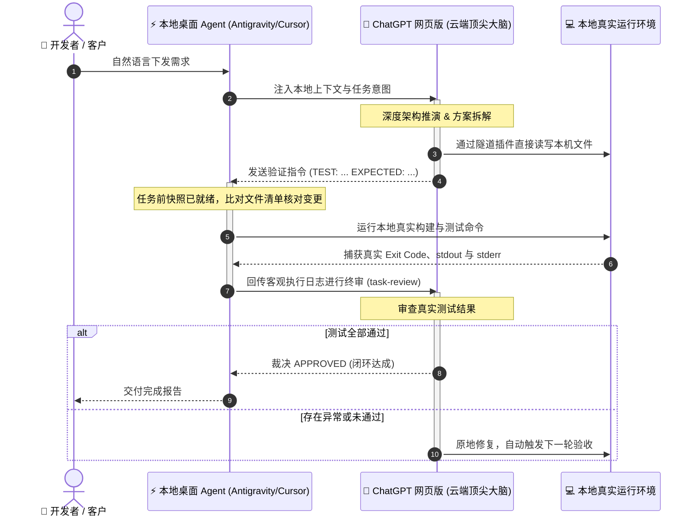

<div align="center">

# 🤖 Antigravity2gptweb
### 纯自然语言驱动的通用“双脑”AI 协作开发桥梁
**Desktop Agent × ChatGPT 网页版 (GPT 5.6 SOL / GPT 6.0 Astra) × 隧道直连本机 全自动闭环**

<br/>

[](LICENSE)
[](https://yvochehk-oss.github.io/Antigravity2gptweb/)
[](https://github.com/yvochehk-oss/Antigravity2gptweb/releases/tag/v1.1.0)
[](https://yvochehk-oss.github.io/Antigravity2gptweb/#download)
[](#-单元测试与架构终审)
[](#-平台支持与跨平台安装)
[](#-安装到-antigravity-ide)
[](#-双脑协作架构与执行时序)
[](#-安全合规与隐私保障)
[](https://github.com/users/yvochehk-oss/projects/2/views/1)
[](https://github.com/yvochehk-oss/Antigravity2gptweb)

<br/>

<p align="center">
  <a href="https://yvochehk-oss.github.io/Antigravity2gptweb/"><b>🌐 访问产品官方首页</b></a> •
  <a href="https://yvochehk-oss.github.io/Antigravity2gptweb/#download"><b>📥 前往官方极速下载中心</b></a> •
  <a href="#-核心价值与痛点解决">核心价值</a> •
  <a href="#-双脑协作架构与执行时序">架构原理</a> •
  <a href="#-驱动通道与加固特性">驱动特性</a> •
  <a href="#-平台支持与跨平台安装">跨平台安装</a> •
  <a href="#-安装到-antigravity-ide">Antigravity 集成</a> •
  <a href="#-单元测试与架构终审">测试与终审</a> •
  <a href="#-安全合规与隐私保障">安全保障</a> •
  <a href="#-实时研发看板-live-roadmap">项目看板</a>
</p>

</div>

---

> 🌟 **项目默认入口与官方网站**：👉 [**https://yvochehk-oss.github.io/Antigravity2gptweb/**](https://yvochehk-oss.github.io/Antigravity2gptweb/)  
> 📥 **官方极速下载与安装中心**：👉 [**https://yvochehk-oss.github.io/Antigravity2gptweb/#download**](https://yvochehk-oss.github.io/Antigravity2gptweb/#download)  
> 包含深色高颜值双脑协作演示、多平台一键免安装下载包、实时产品交付大屏 (Issue #1~#9) 与一键挂载指令！

---

> **一句话愿景**：告别在网页端与代码编辑器之间繁琐的“复制、粘贴、运行、报错、再复制”。你只需在聊天框里用平常说话的自然语言描述需求，桌面 AI Agent 即可自动直连 ChatGPT 网页端顶尖大模型（GPT 5.6 SOL / GPT 6.0 Astra），完成**云端架构推演、隧道直连本机修改落盘、本地变更核对与闭环测试验收**！

---

## 📥 极速下载与安装中心

本项目针对不同操作系统量身定制，均提供预打包免配置 ZIP 安装包与 Git 快捷部署：

> 🚀 **官方可视化下载大屏**：👉 [**https://yvochehk-oss.github.io/Antigravity2gptweb/#download**](https://yvochehk-oss.github.io/Antigravity2gptweb/#download)

### 🍏 1️⃣ macOS 专区（Safari 原生版 & Chrome CDP 版）
> 适用场景：macOS 平台守护进程与扩展通信极度稳定，原生支持双通道驱动。

| 驱动模式 | 官网下载入口 / 备用直链 | 核心组件与特性优势 |
| :--- | :--- | :--- |
| 🍏 **macOS (Chrome CDP 版)** | [**📥 官网下载 macOS 版**](https://yvochehk-oss.github.io/Antigravity2gptweb/#download-macos) <br/><sub>[备用直链 (.zip)](https://github.com/yvochehk-oss/Antigravity2gptweb/archive/refs/heads/main.zip)</sub> | Python CDP 驱动 Chrome / Edge / Brave / Arc / Chromium；以独立数据目录开启 9222 调试端口，ChatGPT 登录态持久保存，不干扰日常浏览器 |
| 🍏 **macOS (Safari 原生极简版)** | [**📥 官网下载 Safari 原生版**](https://yvochehk-oss.github.io/Antigravity2gptweb/#download-macos) <br/><sub>[备用直链 (.zip)](https://github.com/yvochehk-oss/Antigravity2gptweb/archive/refs/heads/main.zip)</sub> | 纯 Safari 原生 AppleScript 驱动，直驱日常已登录 Safari，系统自带 **0 外部扩展 0 依赖**，开箱即用，极简纯净 |

### 🪟 2️⃣ Windows 专区（纯原生 CDP 驱动 · 0 扩展 0 依赖 · 官方推荐）
> 适用场景：Windows 平台采用经过工业级加固的纯原生 CDP 驱动方案，0 扩展 0 依赖，避开安全软件拦截与后台进程保活问题。

| 驱动模式 | 官网下载入口 / 备用直链 | 核心组件与特性优势 |
| :--- | :--- | :--- |
| 🪟 **Microsoft Edge 原生专版** | [**📥 官网下载 Windows 专版**](https://yvochehk-oss.github.io/Antigravity2gptweb/#download-windows) <br/><sub>[备用直链 (.zip)](https://github.com/yvochehk-oss/Antigravity2gptweb/archive/refs/heads/main.zip)</sub> | Windows 10/11 系统内置 Edge，双击 `start_edge_cdp.bat` 秒开；**0 个浏览器插件**；独立持久化数据目录，ChatGPT 登录态永久保存，绝不与日常 Edge 进程冲突 |
| 🪟 **Google Chrome 原生专版** | [**📥 官网下载 Windows 专版**](https://yvochehk-oss.github.io/Antigravity2gptweb/#download-windows) <br/><sub>[备用直链 (.zip)](https://github.com/yvochehk-oss/Antigravity2gptweb/archive/refs/heads/main.zip)</sub> | 双击 `start_chrome_cdp.bat` 一键秒开；驱动端使用 Node.js 18+ 原生引擎，**0 个 npm 依赖包（无需 npm install）**；Windows msvcrt 文件锁保护，稳定性 99.99% |

> 🏷️ **源码与发行说明**：[Releases v1.1.0 官方发行页](https://github.com/yvochehk-oss/Antigravity2gptweb/releases/tag/v1.1.0) \| [下载全量源码包 (.zip)](https://github.com/yvochehk-oss/Antigravity2gptweb/archive/refs/tags/v1.1.0.zip)

---

## 💡 核心价值与痛点解决

过去使用 AI 辅助软件开发或交付项目时，经常面临效率瓶颈：
- 🤯 **思路卡壳 / 架构复杂**：遇到疑难复杂问题不知道如何拆解，需要顶级的深度思考模型（如 GPT 5.6 SOL / GPT 6.0 Astra）来全局指导。
- 😫 **频繁复制极其痛苦**：在 ChatGPT 网页端和本地编辑器之间来回“复制、粘贴、运行、报错、再发回提问”，费时费力且容易出错。
- 💸 **API 账单居高不下**：调用外部 API 不仅上下文计费昂贵，还经常受限于速率上限（Rate Limits）。
- 😨 **改动失控难以挽回**：AI 一次性修改了多个文件导致项目跑不通，找不到原始版本，不知如何优雅回滚。

### 痛点对比一览表

| 维度 | 传统手工 / 纯本地 AI 模式 | 🤖 Antigravity2gptweb 双脑协作模式 |
| :--- | :--- | :--- |
| **交互方式** | 手动在网页与 IDE 间来回搬运代码 | **纯自然语言下发**，全流程自动化闭环 |
| **推理成本** | 昂贵的商业 API 计费、Token 消耗极快 | **零额外 API 成本**，充分复用已有的 ChatGPT Plus/Team 网页订阅 |
| **代码可靠性** | 本地模型经常“幻觉伪造”，改完报错 | **严格闭环验收**：本地真实跑测，GPT 裁决 `APPROVED` 方可交付 |
| **版本安全** | 容易直接覆盖本地代码，改错无法恢复 | **快照严格护栏**：每个任务开始前自动快照 + 文件清单基线，改错随时一键回滚 |

---

## 👥 双脑协作架构与执行时序

本项目采用创新的 **双平面隔离架构 (Dual-Plane Architecture)**：将“思考与代码修改权”交给云端大模型，将“确定性测试与客观证据收集”交给本地桌面环境。

### 协作流程图



### 角色分工与执行铁律

| 角色 | 核心职责 | 行为边界（严禁越位） | 带来的好处 |
| :--- | :--- | :--- | :--- |
| 🧠 **ChatGPT 网页版**<br>*(云端总架构师)* | 负责深度逻辑推演、方案拆解、**通过隧道插件直接读写本机工作目录中的业务文件**、提供测试命令与审核测试结果 | 仅操作用户授权的本机工作目录，独占方案与代码修改权 | 借助网页端顶尖推理能力，保证全局架构与业务代码的高水准 |
| ⚡ **本地桌面 Agent**<br>*(精准验收执行端)* | 负责提取环境上下文、任务前快照与文件清单基线、核对落盘变更、运行真实测试命令、将测试日志回传 GPT 审查 | **严禁越俎代庖编写或覆盖本地业务代码**；GPT 声称完成但零文件变更时直接判 BLOCKED | 用真实环境提供可复核的客观证据，彻底杜绝 AI 幻觉和瞎编 |
| 🛡️ **本地快照**<br>*(版本安全管家)* | 每个任务开始前自动保存工作目录快照与文件清单 | 任何一轮改坏都可用 `restore` 从任务前快照一键恢复 | 落盘证据可核对、变更可回滚，保障本地代码资产安全 |

---

## 🚀 驱动通道与加固特性

统一版只保留三条经过实战验证的驱动通道，并内置以下加固机制：

1. **Safari 原生驱动（macOS）**：
   - 纯 AppleScript 直驱日常已登录的 Safari，复用现有登录态，系统自带 0 扩展 0 依赖；
   - Tab 精确绑定 + 跨进程事务锁，避免多任务串话与误投递。
2. **Chromium CDP 驱动（macOS / Windows）**：
   - macOS 使用 Python 驱动（`chrome_chatgpt.py`），Windows 使用 Node.js 原生引擎（`chrome_chatgpt.js`，0 npm 依赖包）；
   - 以独立持久化数据目录拉起浏览器（Windows 双击 `start_edge_cdp.bat` / `start_chrome_cdp.bat`），ChatGPT 登录态长期保存，绝不与日常浏览器进程冲突；
   - 严格等待 React 水合就绪（`isContentEditable === true`），通过原生 CDP 物理点击 `button[data-testid="send-button"]`，彻底解决 ProseMirror 多行长文本误插入换行的问题；
   - 提交成功判据为“DOM 中实际出现匹配预期内容的 User 消息节点”，绝非仅依赖按键事件返回。
3. **跨平台 P0 级文件锁与状态隔离**：
   - POSIX / macOS 平台使用 `fcntl.flock`，Windows 原生平台使用 `msvcrt.locking`；
   - 锁文件统一存放于 `tempfile.gettempdir()`，生命周期由操作系统内核管理，进程异常中断自动释放，彻底避免死锁；各驱动熔断器使用独立状态文件，互不影响。
4. **增强型凭据脱敏**：
   - 过滤覆盖 Cookie、Authorization、Basic Auth、带用户名密码的 URI，全面守护企业资产。

---

## 📦 平台支持与跨平台安装

本项目统一发布于 `main` 分支：同一仓库同时包含 macOS 与 Windows 两套驱动，按操作系统选用对应通道即可，无需切换分支，也无需安装任何臃肿庞大的第三方依赖包。

| 平台 | 分支 | 运行时要求 | 浏览器驱动通道 | 特性优势 |
| :--- | :--- | :--- | :--- | :--- |
| **macOS** | `main` | Python 3 | **Safari AppleScript** / Chrome CDP (Python) | Safari 原生零配置直驱已登录会话；Chromium 家族（Chrome / Edge / Brave / Arc）统一走 CDP |
| **Windows 10/11** | `main` | Node.js 18+ | **Edge / Chrome 原生 CDP 驱动** | **纯原生引擎**，内置 `start_edge_cdp.bat` / `start_chrome_cdp.bat`，**0 个 npm 依赖包，0 个浏览器扩展**，避开安全软件拦截与 Defender 误报 |

### 独立终端快速运行

#### 🍏 macOS 快速启动

* **方式 A：Chrome CDP 版（Chromium 家族通用）**
  ```bash
  git clone --depth 1 https://github.com/yvochehk-oss/Antigravity2gptweb.git chatgpt-web-reasoner
  cd chatgpt-web-reasoner

  # 以调试端口启动 Chrome（独立数据目录，登录态持久保存）
  /Applications/Google\ Chrome.app/Contents/MacOS/Google\ Chrome \
    --remote-debugging-port=9222 --user-data-dir="$HOME/.chatgpt-cdp-profile"

  # 在弹出的窗口中登录 ChatGPT 并打开目标会话后，发送任务
  python3 scripts/chrome_chatgpt.py \
    --target-url "https://chatgpt.com/c/<conversation-uuid>" \
    --prompt "你的任务需求"
  ```

* **方式 B：Safari 纯原生极简版（系统自带零配置）**
  ```bash
  python3 scripts/safari_chatgpt.py --help
  ```

#### 🪟 Windows 快速启动（纯原生 CDP 驱动 · 0 依赖 0 插件）

```cmd
:: 1. 克隆仓库（统一 main 分支）
git clone --depth 1 https://github.com/yvochehk-oss/Antigravity2gptweb.git chatgpt-web-reasoner
cd chatgpt-web-reasoner

:: 2. 双击运行启动 Edge（或 start_chrome_cdp.bat 启动 Chrome）
start_edge_cdp.bat

:: 3. 在弹出的 Edge 窗口中登录 ChatGPT 并打开目标会话

:: 4. 运行原生 Node 驱动（0 npm 依赖包，开箱即用）：
node scripts\chrome_chatgpt.js --browser-name edge --target-url "https://chatgpt.com/c/你的会话ID" --prompt "你的任务需求"
```

---

## 🚀 安装到 Antigravity IDE

本项目支持一键作为 Skill 挂载至 Google Antigravity IDE 或其他桌面 Agent 环境：

### 1. 全局安装（所有本地项目通用）

* **macOS**：
  ```bash
  mkdir -p ~/.gemini/antigravity/skills
  git clone \
    https://github.com/yvochehk-oss/Antigravity2gptweb.git \
    ~/.gemini/antigravity/skills/safari-chatgpt-reasoner
  ```

* **Windows PowerShell**：
  ```powershell
  New-Item -ItemType Directory -Force "$env:USERPROFILE\.gemini\antigravity\skills" | Out-Null
  git clone https://github.com/yvochehk-oss/Antigravity2gptweb.git "$env:USERPROFILE\.gemini\antigravity\skills\safari-chatgpt-reasoner"
  ```

### 2. 项目级安装（随项目团队代码库分发）

在项目的根目录下执行：
```bash
mkdir -p .agent/skills
git clone \
  https://github.com/yvochehk-oss/Antigravity2gptweb.git \
  .agent/skills/safari-chatgpt-reasoner
```
*(macOS 与 Windows 使用同一 `main` 分支，无需区分。)*

### 3. 一键更新
```bash
git -C ~/.gemini/antigravity/skills/safari-chatgpt-reasoner pull --ff-only
```

---

## 🧪 单元测试与架构终审

为确保跨平台稳定性与生产环境可靠性，项目建立了覆盖全面的自动化测试套件：

| 测试套件 | 覆盖内容 | 用例数 | 状态 |
| :--- | :--- | :---: | :--- |
| `tests/test_orchestrator_contract.py` | 最大 3 次重试契约、已移除驱动契约、本地只读（不 commit / 不 push）契约、无残留旧命令契约 | 4 | ✅ PASS (0.001s) |
| **总计** | **统一版全量回归测试** | **4** | **✅ 100% 全部通过** |

**云端架构终审结果**：通过云端 Custom GPT 实时审查全部代码并进行双向物理握手，最终裁决：**`架构终审闭环通过`**。

---

## 🛡️ 安全合规与隐私保障

1. **自动敏感凭据脱敏**：
   内置自动化安全正则扫描引擎，所有提交与回传日志中的 API Key（如 `sk-...`）、授权 Token 会被自动转换为掩码（`[OPENAI_KEY]`），确保任何敏感凭据绝不泄露到网络中。
2. **快照 + 清单双重防覆盖机制**：
   每个任务开始前自动给工作目录做快照并记录文件清单（sha256）。GPT 声称完成但清单零变更时直接判 BLOCKED；任何一轮改坏可用 `orchestrate.py restore` 从任务前快照恢复，绝不让错误改动无声覆盖开发者已写好的业务代码。
3. **完全所有权**：
   用户始终拥有对本地工作目录与运行环境的绝对控制权，代码只存储在您的本地机器中。

---

## 📊 实时研发看板 (Live Roadmap)

为了让客户和使用者清晰了解项目的迭代动态，我们设立了公开的实时项目看板：

👉 **[点击访问 GitHub Project 2 实时交付看板](https://github.com/users/yvochehk-oss/projects/2/views/1)**

| 阶段 | 交付目标 | 状态 |
| :--- | :--- | :--- |
| **Q3 核心闭环** | Safari & Edge/Chrome 双向自动化桥接与任务审查协议 | `✅ 已发布 (Done)` |
| **Q3 跨平台** | Windows 零 npm 依赖 Node.js CDP 原生引擎 | `✅ 已发布 (Done)` |
| **v1.1.0 深度加固** | 独立数据目录隔离运行、React 水合检测与原生 CDP 点击、跨平台文件锁统一 (POSIX/msvcrt) 与自动化测试矩阵 | `✅ 已发布 (Done)` |
| **统一版收敛** | 全平台代码统一至 `main` 分支；移除 Browser-Skill 驱动，macOS 保留 Safari + Chrome、Windows 保留 Edge + Chrome | `✅ 已发布 (Done)` |
| **Q4 体验增强** | 多浏览器自动探测、端口智能动态适配与长会话平滑交接 (Handoff) | `🚀 进行中 (In Progress)` |
| **Q4 开放生态** | 企业私有知识库挂载与多 Git 仓库联合协同编排流水线 | `📋 规划中 (Backlog)` |

---

## 🤝 反馈与参与贡献

欢迎通过 GitHub 提交反馈与需求：
* 遇到异常或 Bug：欢迎提交 [Bug Report](https://github.com/yvochehk-oss/Antigravity2gptweb/issues/new?template=bug_report.md)
* 新增功能建议：欢迎提交 [Feature Request](https://github.com/yvochehk-oss/Antigravity2gptweb/issues/new?template=feature_request.md)
* 驱动升级需求看板：查看 [Issue #9](https://github.com/yvochehk-oss/Antigravity2gptweb/issues/9)
* 安全漏洞通报：请查阅 [SECURITY.md](SECURITY.md)

---

## ⭐ 开源协议与支持

本项目基于 [MIT License](LICENSE) 开源。

如果本项目为您的日常开发与 AI 协作带来了帮助与启发，欢迎在 GitHub 右上角为我们点亮一颗 **⭐ Star**！您的支持是项目持续迭代的最大动力！
